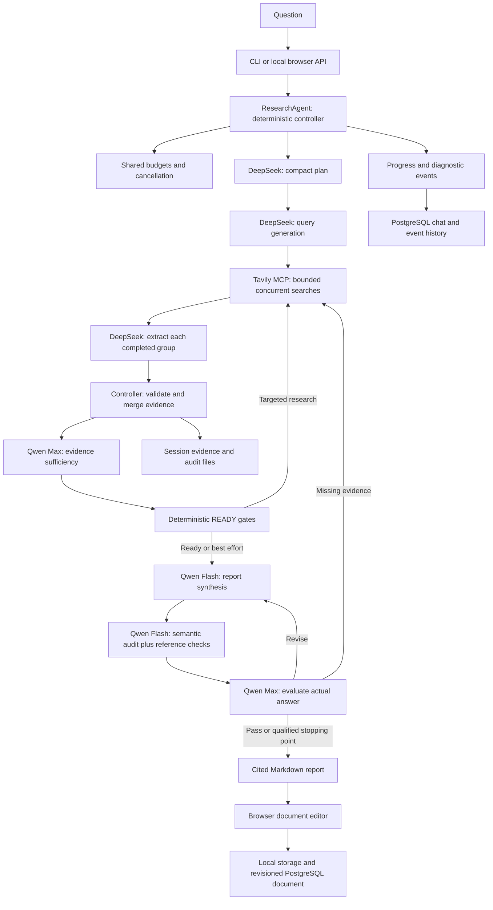

# Project structure and independent review

Reviewed 14 October 2026 against the current working tree, including existing uncommitted changes. This document describes executable behavior, distinguishes the default pipeline from compatibility code, and marks defects and limitations. Model IDs and capability ceilings below are values in the local configuration and registry; this review does not establish live account availability or independently reverify vendor specifications.

## 1. What the project is

DeepSearchAgent is a local research application. It turns one question into an evidence plan, searches the web, extracts claims with source excerpts, evaluates coverage, writes a cited report, and evaluates the actual answer. It can run through a CLI or a browser interface. The browser additionally provides saved history, editable reports, diagnostics, and export.

The central authority is deterministic Python orchestration. Models return structured proposals; they do not execute tools or choose arbitrary next actions. Searches and extraction overlap, while judging and writing follow their evidence dependencies.

Each question starts a new isolated research session. Saved chats are history/replay records: earlier conversations are not automatically included in the next question's model context. There is no embedding model, vector database, fine-tuning, model training, autonomous browser, or general tool-execution agent. Retrieval uses Tavily results and deterministic passage selection.



## 2. Complete logical repository map

Generated dependencies, caches, credentials, database data, and research results are separated from source. Existing local output folders may contain additional artifacts.

```text
deepsearchagent/
├── pyproject.toml                 Python package, dependencies, CLI entry points
├── uv.lock                       Locked Python dependency resolution; tracked
├── package.json                  Editor dependencies and Node/browser commands
├── package-lock.json             Locked JavaScript dependency resolution; tracked
├── .env.example                  Documented environment settings
├── .env                          Local configuration/credentials; ignored
├── .gitignore                    Excludes generated/sensitive local data
├── README.md                     Setup, user behavior, integration contracts
├── playwright.config.cjs         Browser projects, fixture server, visual tests
├── .github/workflows/
│   ├── qa.yml                    Deterministic checks, DB, browsers, load, audits
│   └── live-smoke.yml            Explicitly enabled provider checks
├── src/deepsearchagent/
│   ├── __init__.py               Compatibility package entry function
│   ├── __main__.py               python -m deepsearchagent → CLI
│   ├── cli.py                    Argument parsing, providers, report/state exports
│   ├── ui.py                     Local HTTP API, background jobs, event replay
│   ├── orchestrator.py           DEFAULT asynchronous pipeline and transitions
│   ├── sequential.py             LEGACY explicit LangGraph compatibility pipeline
│   ├── planner.py                Plan/query generation, recovery, query grouping
│   ├── retrieval.py              Async query fan-out and awaited result acceptance
│   ├── researcher.py             Bounded passages, extraction, partial recovery
│   ├── evidence_store.py         Provenance checks, stable IDs, durable snapshots
│   ├── judge.py                  Judge transports and deterministic decision gates
│   ├── verifier.py               Legacy verification stage
│   ├── writer.py                 Synthesis input, draft validation, audit, rendering
│   ├── models.py                 Pydantic contracts and ResearchState
│   ├── llm.py                    OpenAI-compatible completion/stream adapter
│   ├── config.py                 Environment loading and configuration validation
│   ├── capabilities.py           Model limits and inference parameter support
│   ├── model_catalog.py          Account model listing; API endpoint still exists
│   ├── budget.py                 Shared reservations, stage limits, model retries
│   ├── cancellation.py           Cooperative cancellation and blocking-call wrapper
│   ├── diagnostics.py            Failure categories, issue history, safe JSONL logs
│   ├── progress.py               Human-readable status from actual stage events
│   ├── pricing.py                Reference/custom price metadata
│   ├── history.py                PostgreSQL chats, events, edited documents
│   ├── benchmark.py              Prepare/predict/score evidence-judge benchmarks
│   ├── system_prompt.py          Shared prompt builder, principally legacy/direct use
│   ├── prompts/
│   │   ├── system.md             Broad research instructions
│   │   ├── evidence-judge.md     Evidence coverage/readiness rubric
│   │   ├── judge.md              Final-answer relevance/quality rubric
│   │   └── writer.md             Analytical synthesis and report-format instructions
│   ├── tools/
│   │   ├── __init__.py           Tools package
│   │   ├── search.py             Routing, deduplication, cache, admission, pacing
│   │   ├── retry.py              Retry-After, backoff, retry cap, circuit breaker
│   │   ├── tavily.py             Streamable HTTP MCP transport and tavily_search
│   │   ├── fetch.py              Parse Tavily JSON/text; does not fetch URLs itself
│   │   ├── documentation.py      Injectable documentation-search callback
│   │   └── financial.py          Financial-source instructions; no market-data feed
│   └── web/
│       ├── index.html            Browser application markup
│       ├── style.css             Responsive, editor, print, diagnostic styling
│       ├── app.js                Question submission, stream/replay, history/export
│       ├── dashboard.js          Call waterfall, usage/cost, error/recovery display
│       └── editor.js             Built/minified editor bundle; generated from frontend
├── frontend/
│   ├── report-editor.js          Maintainable editor source and autosave/revisions
│   └── report-media.js           MathML formulas and validated SVG bar charts
├── scripts/
│   ├── start_postgres.py         Start/preserve isolated local PostgreSQL cluster
│   ├── import_chat_history.py    Idempotent import of old reports/traces
│   ├── check_integrations.py     Optional live model/search/research probes
│   ├── evaluate_writers.py       Frozen-evidence writer comparison; live opt-in
│   ├── run_tests.py              Suite selection, isolation, coverage, QA artifacts
│   ├── qa_checks.py              Fatal lint, selected formatting and type checks
│   ├── qa_evaluate.py            Scripted quality/coverage-gate evaluation
│   ├── qa_load.py                Fake-provider concurrency/load/soak measurements
│   └── qa_report.py              Consolidate QA artifacts and readiness evidence
├── tests/
│   ├── test_*.py                 Backend, contracts, orchestration, storage, security
│   ├── test_web.cjs              Node built-in component tests
│   ├── support_fixtures.py       Deterministic providers and pipeline fixtures
│   ├── support_quality.py        Quality evaluation helpers
│   ├── fixtures/*.json           Versioned workflows and adversarial gate fixtures
│   └── browser/                  Playwright workflows/editor/errors/accessibility
│       └── snapshots/darwin/     Reviewed macOS visual baselines
├── benchmarks/
│   ├── README.md                 Human-labeling and benchmark procedure
│   └── review_queue.jsonl        225 synthetic, unlabeled evidence snapshots
├── docs/                         Migration, implementation, writer/performance reviews
│   └── qa/                      Architecture, matrix, tests, readiness, handoffs
├── reports/                      Ignored research sessions, logs, QA artifacts
└── .postgres/                    Ignored local database cluster/data
```

## 3. Technologies and their actual roles

Versions are declarations from package manifests, not a claim that all installed versions equal their lower bounds.

| Technology | Declared version / form | Role |
|---|---|---|
| Python | 3.11+ | Backend, CLI, controller, storage and QA scripts |
| asyncio | Standard library | Concurrent searches, dependency events, controller loop |
| threading / futures / contextvars | Standard library | Blocking model workers, locks, cancellation, trace context |
| http.server | ThreadingHTTPServer | Local browser API; no FastAPI/Django service |
| OpenAI Python SDK | >=3.28.0 | Compatible Chat Completions calls to Aliyun, Moonshot, optional PAI; OpenAI models are not configured |
| Pydantic | >=2.12.0 | JSON schemas, strict response validation, typed state |
| LangGraph | >=1,<2 | Separate sequential compatibility workflow; imported by default module but not used to route its async pipeline |
| MCP Python SDK | >=1.26,<2 | Tavily Streamable HTTP client/session/tool calls |
| HTTPX | >=0.28,<1 | Async Tavily HTTP transport and model-catalog HTTP requests; also under SDK transports |
| python-dotenv | >=1,<2 | Working-directory .env loading without modifying process environment |
| PostgreSQL + psycopg[binary] | psycopg >=3.2,<4 | Persistent history/events and report document revisions; CI uses PostgreSQL 16 |
| uv / uv_build | build >=0.12.1,<0.13.0 | Python environment, packaging and locked installation |
| JavaScript, HTML, CSS | Browser-native | Application and diagnostics UI; no React/Vue app |
| Fetch + ReadableStream + NDJSON | Browser/native HTTP | Incremental events and sequence-based replay; not SSE or WebSocket |
| Tiptap / ProseMirror | Tiptap ^3.31.4 | Rich document editing, links, tables, undo/redo, Markdown; custom code-block extension |
| marked | ^18.1.1 | Parse Markdown for initial document rendering |
| DOMPurify | ^3.4.17 | Sanitize rendered HTML |
| KaTeX | ^0.19.0 | Untrusted formula previews rendered as MathML |
| SVG DOM | Browser-native | Deterministic bar-chart previews; no chart generation service |
| localStorage | Browser-native | Recover unsynced report edits locally |
| esbuild | ^0.28.2 | Bundle frontend source into shipped editor.js |
| unittest, Node test runner | Built-in | Backend and JavaScript component regression tests |
| Playwright / axe | ^1.56.0 / ^4.11.0 | Browser matrix, accessibility automation, visual regressions |
| coverage / Hypothesis | Development dependencies | Line/branch coverage and property-based invariants |
| Ruff / mypy / pip-audit / npm audit | Development/QA tools | Scoped code checks and dependency advisory scans |
| GitHub Actions | Two workflows | Deterministic CI and optional live smoke |

## 4. Models: active roles versus optional support

The sanitized `Config.from_env()` snapshot during this review resolves to the following. A running server may have an older already-created run configuration; this snapshot does not inspect its live state.

| Role | Current model | Provider | What it decides |
|---|---|---|---|
| Brief planner | deepseek-v4.1-flash | Aliyun Model Studio | Objective, steps, requirements, criticality and weights |
| Query generator | deepseek-v4.1-flash | Aliyun | Search strings and requirement associations |
| Evidence extractors | deepseek-v4.1-flash | Aliyun | Claims, verbatim excerpts, evidence status, limitations/conflicts |
| Evidence sufficiency judge | qwen3.8-max | Aliyun | READY / RESEARCH_MORE / INSUFFICIENT_EVIDENCE |
| Final writer | qwen3.8-flash | Aliyun | Report structure, synthesis, paragraph-to-finding references |
| Semantic report auditor | qwen3.8-flash | Aliyun | Whether each paragraph is supported by its cited evidence |
| Answer-quality evaluator | qwen3.8-max | Aliyun | PASS / REVISE / MORE_RESEARCH / INSUFFICIENT_EVIDENCE and quality scores |
| Search | No project-selected LLM | Tavily MCP | External search returns pages/content; internal Tavily models are unspecified |

Research endpoint host: `maas.qianwenaiapi.com`. Research thinking is enabled with `reasoning_effort=low`. Query generation explicitly disables thinking when the registry supports that switch; audit also requests thinking off. Qwen3.8 entries do not advertise an inference switch in this registry, so those requests omit it. Do not infer that omission guarantees a provider-side thinking mode.

Other supported configurations: Moonshot/Kimi research/writer/judge, an optional separate PAI judge, or a judge reusing the research backend. The fallback judge is disabled in the current snapshot. `qwen-flash` is its stored default model, but is not being called merely because that setting exists.

The capability registry recognizes Aliyun `deepseek-v4.1-flash`, `qwen3.8-flash`, `qwen3.8-max`, `qwen3.7-plus`, `qwen-plus`, `qwen-flash`; Moonshot `kimi-k3*`, `kimi-k2.6`, `kimi-k2.5`, `kimi-k2`. Unknown models get conservative 32,768 context / 8,192 output ceilings and local JSON validation. The registry's nominal ceilings are 1,000,000 / 393,216 for DeepSeek, 1,000,000 / 131,072 for the listed Qwen3.8/3.7 models, and 262,144 / 32,768 for the listed Kimi models. Stage and shared budgets normally constrain requests much more tightly.

Model selection is configurable rather than empirically justified by this review. There is no completed human comparison here proving the current trio is optimal.

## 5. One complete research run, step by step

1. **Accept and isolate.** CLI/UI construct the provider backend, Tavily router and Config. The browser accepts 1–8,000-character questions, persists the accepted chat, and rejects a second active UI job. `arun()` assigns a separate session UUID, creates an EvidenceStore directory, and writes initial state. Browser run ID and research session ID serve different purposes.
2. **Define evidence requirements.** DeepSeek returns a PlanningBrief: one objective, short steps, and up to eight requirements. Each requirement has an ID, critical flag and positive weight. The prompt asks for 2–5 steps, but the schema accepts 1–5. Recoverable planning failures use complete partial fields or a deterministic compact plan from the question.
3. **Generate executable queries.** A separate DeepSeek call returns QueryBatch, up to 15 queries. Python removes invalid requirement references, deduplicates queries, generates searches for uncovered requirements, assigns stable Q IDs, and groups consecutive queries in batches of at most five. At most three initial extraction groups result. The prompt's two-queries-per-requirement preference is not a hard schema limit.
4. **Search concurrently.** Retrieval creates query tasks. SearchRouter shares identical in-flight requests, caches per-run results, deep-copies returned results, admits up to five transports, and spaces actual starts at five per second. Every started retry counts against shared search limits. The default pipeline sends all queries to the web provider.
5. **Call Tavily.** Each search attempt creates an HTTPX client and MCP session, initializes MCP, and invokes `tavily_search` with advanced depth, max_results=5, raw content enabled, images disabled. The parser accepts structured JSON or supported detailed text. It retains full returned document content; the 8,000-character constant caps snippets, not stored raw content.
6. **Select bounded original passages.** Each extraction group waits for its own search results, then can start while other groups are still searching. The input samples results across queries, suppresses duplicate/similar documents, and chooses one contiguous passage per admitted document using keyword matches. A passage is capped at 3,500 characters; it is not an embedding-ranked or model-generated summary.
7. **Extract structured evidence.** DeepSeek receives the question, assigned requirements, queries, admitted documents and a small existing-finding sample. It proposes claims with exact source IDs/URLs, verbatim excerpts, statuses, limitations, contradictions and uncertainties. The prompt asks for at most eight findings; the schema permits up to 40. Partial generations may salvage complete schema-valid findings.
8. **Consolidate on the controller.** Python rejects unknown requirements or source references, verifies each excerpt exists in its particular retrieved document after whitespace normalization, marks unmatched excerpts UNVERIFIED, deduplicates claim/source/requirement triples, assigns global F IDs, and persists state. Only the controller mutates consolidated evidence. Disk workers receive frozen snapshots.
9. **Evaluate evidence sufficiency.** Qwen Max receives a bounded snapshot of findings, source metadata, requirements, executed queries and remaining budget. Python validates every requirement assessment and all referenced IDs. READY must pass independent structural gates. RESEARCH_MORE can trigger up to five fresh queries targeting unresolved critical requirements. Initial evidence research allows two additional rounds by default and stops on exhausted limits, no usable new queries, insufficiency or negligible later-round gain.
10. **Write the answer.** Qwen Flash receives eligible findings, requirements, latest evaluation, and selected original passages up to 6,000 characters per admitted source. It returns structured sections/paragraphs with finding_ids. On revision it also receives the previous draft and targeted feedback. It cannot search. The prompt requests a `tldr:` opening and Conclusion; these format preferences are not hard-coded validators.
11. **Validate citations and semantics.** Python checks every paragraph has eligible finding references and covered essential requirements appear. The writer model performs a paragraph-by-paragraph semantic audit. Python verifies all paragraph IDs are assessed and every assessment is supported. Rendering adds links only from stored sources. Failed synthesis/audit falls back to qualified stored findings, or preserves a previous draft when available.
12. **Evaluate the rendered answer.** Qwen Max sees the original question, requirements, actual rendered report, bounded evidence and completion information. Python validates IDs, critical requirement support and score gates. PASS finalizes; REVISE rewrites; MORE_RESEARCH retrieves only missing requirements before reassessment and rewriting; INSUFFICIENT_EVIDENCE retains explicit limitations. Two improvement iterations are allowed, meaning up to three answer assessments.
13. **Finalize and expose.** The controller records usage, derives terminal status, persists evidence/state/report, and emits completion. The UI emits the final answer line by line after the entire controller returns, including answer-quality evaluation. Earlier `report_preview` trace events can show an explicitly incomplete draft. Final editable documents are saved separately from original research events.

A successful initial run with all three extraction groups ordinarily needs nine logical model calls: two planning calls, three extraction calls, evidence judge, writer, semantic audit, answer judge. Retries and refinements increase that count; simpler plans use fewer extraction calls.

## 6. Decisions and control boundaries

| Decision | Model proposal | Python authority |
|---|---|---|
| What evidence to seek | Planner requirements/weights/criticality | Schema and plan mapping validation; no independent semantic requirement extraction |
| What to search | Initial query generator or judge suggestions | Deduplication, requirement association, query counts, budgets |
| Whether a claim is source-backed | Extractor status and excerpt | Known source/requirement checks and excerpt membership |
| Whether research is ready | Evidence judge | Coverage threshold, critical support, contradiction/reference gates |
| Whether more research runs | Judge suggestion | Iteration bounds, new queries, minimum gain, resources/cancellation |
| What to write | Writer | Eligible references, bounded snapshot, deterministic renderer |
| Whether prose follows evidence | Semantic audit and independent answer judge | Complete audit IDs, rejection/fallback, answer score/reference gates |
| Whether the session is COMPLETE | No model directly owns this | Final controller predicate |

READY requires model coverage >=0.90, independently computed weighted COVERED coverage >=0.90, no critical gaps, no current/stored contradictions, and every critical requirement COVERED with fully SUPPORTED excerpt-backed findings from known sources. An UNVERIFIED or CONTRADICTED finding attached to a critical requirement also blocks readiness. PARTIALLY_SUPPORTED evidence can appear in qualified answers but cannot establish critical READY support.

Evidence/reliability scores are recorded but are not separate numerical READY thresholds. Source authority, freshness and claim entailment primarily depend on model assessments. Excerpt membership proves provenance, not that the excerpt logically entails the claim.

Answer scores use a recomputed weighted mean: relevance 30%, requirement coverage 25%, factual grounding 20%, citation quality 10%, analytical quality 10%, uncertainty handling 5%. Default minimum relevance/coverage, grounding/citation and overall scores are 4/5. Critical requirements need covered claim IDs actually cited in the answer. Hard failures downgrade a proposed PASS to REVISE. These scores are judgments, not calibrated accuracy probabilities.

Final COMPLETE additionally requires stop_reason=coverage, report_status=generated, quality_status=pass, no failure, and no research limitations, unresolved questions or stored contradictions. Otherwise the run is CANCELLED, PARTIAL when findings exist, or FAILED when they do not. Output can still be useful when PARTIAL.

## 7. Current operational settings

| Control | Current value | Meaning / caveat |
|---|---:|---|
| MAX_SECONDS | 600 | Shared run deadline; external requests already submitted may outlive local waiting |
| MAX_CALLS | 20 | Shared model attempts, including retries and judging |
| MAX_TOKENS | 240,000 | Observed usage plus pending conservative reservations |
| MAX_SEARCHES | 25 | Actual started searches, including retries; not 25 unique queries |
| MAX_ROUNDS | 2 | Additional evidence-stage rounds; quality research has its own iteration loop |
| QUALITY_MAX_ITERATIONS | 2 | Additional answer improvements; up to three assessments |
| LLM_CONCURRENCY | 3 | StageBackend model admission, principally concurrent extraction |
| SEARCH_CONCURRENCY / rate | 5 / 5 per second | Transport parallelism and actual-start pacing |
| LLM_RETRIES | 2 | Up to two recovery retries for selected transient/validation errors |
| SEARCH_RETRIES | 3 | Up to three retries per failed query; attempts also use MAX_SEARCHES |
| MAX_SEARCH_RETRIES | 25 | Additional shared retry ceiling |
| Search circuit | 8 failures / 30 seconds | Open after enough terminal retryable query failures; successful searches reset failure count |
| JUDGE_RETRIES | 1 | One independent-judge retry; explicit fallback is optional |
| REQUEST_TIMEOUT / JUDGE_TIMEOUT | 120 / 60 seconds | Per-stage/attempt limits within the run deadline |
| WRITER_RESERVE | 48,000 tokens / 60 seconds | Protected finishing headroom; does not guarantee all final stages can finish |
| MAX_COST_USD | Unset | No active monetary ceiling; default Aliyun models require account rates for complete pricing |
| MAX_CONTINUATIONS | 0 | Current stages explicitly disable automatic JSON continuation |

Input allowances: planner 24,000, extractor 24,000, writer 64,000, judge 96,000. Output settings: planner/extractor 16,384, writer 32,768, judge 16,384, audit 8,192. The controller further caps both planner calls at 4,096 output with 30-second timeouts and semantic audit at 4,096 output with 20 seconds. Model capability and remaining resources can reduce allocations further.

Input sizing uses UTF-8 byte length as a conservative token bound. These values therefore do not represent the same usable text capacity as actual tokenizer counts.

Configuration precedence is dataclass defaults, working-directory .env, exported environment, then non-null explicit overrides. RESEARCH_MODEL becomes the effective research model. CLI exposes provider/model/endpoint and major limits; backend-only writer/judge settings are environmental. The browser removed visible model selectors, but API provider/model overrides and `/api/models` remain implemented.

## 8. Storage, browser controls and recovery

Session files under `reports/sessions/<session-id>/`: `research_facts.md`, `state.json`, `report.md`, optional `report.partial.md`, `evaluation-N.json`, `quality-evaluation-N.json`, and partial-generation checkpoint JSON. Evaluation records include exact bounded inputs, provider/model, advisory versus accepted decision, evidence version and SHA-256. Snapshot files are individually fsynced and atomically replaced; the collection is not one crash transaction and does not support automatic research resume.

PostgreSQL tables: `chats` for status/question, `chat_messages` for original question/report, `chat_events` for sequence-numbered full replay payloads, and `report_documents` for edited Tiptap JSON/Markdown/revision. SQL uses parameters. Every connection currently has a three-second connect and five-second statement timeout.

Browser controls include Start, Stop, Reconnect, New chat, saved-history selection/pagination, developer diagnostics, report/trace downloads, rich editing, reading view, Markdown copy/export and browser Print/PDF. Autosave first keeps a local copy and then submits a revision-checked server save after a 500 ms debounce. HTTP 409 preserves conflicting edits for export. Editing does not re-run research, change evidence, or revalidate new claims.

| HTTP endpoint | Function |
|---|---|
| GET /api/status | Configuration presence, research model, busy/history/log status |
| POST /api/research | Accept new question or reuse existing run ID |
| GET /api/research/{id}?after=N | Replay/continue NDJSON events after a sequence |
| POST /api/research/{id}/stop | Cooperative cancellation |
| GET /api/chats and /api/chats/{id} | History listing and full saved chat/events |
| GET/POST /api/documents/{id} | Retrieve/save edited document with revision conflict protection |
| GET /api/models?provider=... | Optional account model catalog; still callable |

Reconnect retries up to three times and reuses the run ID. Heartbeats occur every ten seconds. Five recent runs remain in memory; PostgreSQL retains older chats. Disconnecting the browser does not cancel research. Server restart marks unfinished chats interrupted instead of silently repeating paid work.

The app binds to 127.0.0.1, validates Host/Origin against localhost, enforces a restrictive CSP, sanitizes Markdown, limits request sizes, restricts source URLs, and validates session paths. It has no account authentication, multi-user authorization, durable task queue or distributed workers. The bundled PostgreSQL setup uses trust authentication for its local cluster; treat it as a local development setup.

Full saved traces/events contain research content and provider deltas. Diagnostic JSONL uses an allowlist and omits the ordinary query/source/answer streams. Downloaded full traces and session state are therefore different from metadata logs in content and sensitivity.

## 9. Explicit compatibility path

`SequentialResearchAgent` is re-exported from orchestrator.py and implemented in sequential.py with LangGraph START → plan → research → verify → follow-up or write → END. It uses older ResearchPlan/ResearchTask, Extraction and Verification contracts, sequential searches, and legacy prompt construction. It does not provide the default pipeline's equivalent evidence store, independent final-answer loop, or reservation policy.

DocumentationSearch is a callback integration point and can be used through the compatibility workflow. In the default async pipeline, PlannedQuery has no source selector and retrieval constructs web tasks, so injecting a documentation provider alone does not make that pipeline use it.

Several older UI/cancellation/diagnostic tests explicitly patch in the compatibility agent; newer fixtures/browser tests exercise the default orchestrator. Test count alone does not tell you which workflow was validated.

## 10. Weak spots, ordered by importance

**High — Negative evidence reassessment can be ignored.** In [evidence_store.py](../src/deepsearchagent/evidence_store.py), lines 91–100, an existing finding changes only when the new status has a higher strength. SUPPORTED outranks CONTRADICTED/UNVERIFIED, so later adverse assessments of the same claim/source/requirement leave the old SUPPORTED record and may discard new limitations. An offline probe confirmed SUPPORTED remained after a CONTRADICTED reassessment. Add versioned assessments or explicit downgrade/conflict rules; preserve both observations and require resolution before eligibility.

**High — Gaps/conflicts have no resolution lifecycle.** Store merge, lines 109–110, only appends contradictions and uncertainties. Subsequent clean extraction cannot remove resolved entries. Stored contradictions block READY and both collections block COMPLETE. Offline probes confirmed both remained after a clean later merge. Use structured issue IDs with open/resolved state and resolution evidence, retaining historical text separately.

**High — Quality recovery leaves a stale stop reason.** [orchestrator.py](../src/deepsearchagent/orchestrator.py), lines 631–650, reevaluates evidence after quality-driven research without updating the original stop reason. Finalization at lines 739–743 requires coverage. A probe produced latest READY, generated report, quality PASS, no limitations, but stop_reason=round_limit and status=PARTIAL. Track termination and current evidence readiness separately or reconcile them after recovery.

**Medium — Two round controls are easy to misunderstand.** MAX_ROUNDS limits the initial evidence loop, while quality MORE_RESEARCH can start additional rounds. With MAX_ROUNDS=0 the probe ran two retrieval rounds. This is bounded by other resources and quality iterations, but it contradicts a natural interpretation of one global round cap. Expose a clearly named global retrieval-round limit or document separate limits. Default code can attempt three initial/evidence rounds plus two quality rounds, subject to the shared search/call/time budgets.

**Medium — Finishing reserves protect less than the full finishing pipeline.** [budget.py](../src/deepsearchagent/budget.py), lines 38–56, protects one model call and configured token/time headroom. Normal finishing requires writing, semantic audit and answer assessment, before any revision. The reserve can be exhausted after writing, leaving quality unverified. Reserve an explicit finishing-stage envelope rather than only one call; show which assurance could not complete.

**Medium — Database persistence sits on streaming/cancellation locks.** [ui.py](../src/deepsearchagent/ui.py), lines 53–108, saves every event while holding run.condition. [history.py](../src/deepsearchagent/history.py), lines 21–23 and 76 onward, opens/commits a new connection per event. Model deltas and final per-line answer events can create many writes. Slow PostgreSQL delays delivery and Stop; this is confirmed code structure, not a latency measurement made in this audit. Use bounded pooled connections and ordered batched persistence with explicit terminal flush/replay rules.

**Medium — The advertised shared system prompt is bypassed by the default stages.** [budget.py](../src/deepsearchagent/budget.py), lines 15–17 and StageBackend request construction, builds and supplies its own system_prompt. [llm.py](../src/deepsearchagent/llm.py), line 184, uses build_system_prompt only if no override is supplied. Therefore changes to prompts/system.md do not automatically affect default planner/extractor/writer stages. Consolidate prompt composition and test the actual sent request for each role. Stage-specific safety instructions and writer/judge prompts still apply.

**Medium — Retrieval can miss decisive material.** [researcher.py](../src/deepsearchagent/researcher.py), relevant_passage/group_payload, uses keyword counts and one 3,500-character window; first matches and similar-prefix suppression can hide tables, qualifiers or opposing material elsewhere in a long document. Full text survives storage, but downstream judgments often see excerpts rather than the whole source. Use requirement-specific multiple passages/table-aware extraction and add long-document tests with late counterevidence. This is a design limitation, not proof of a particular bad answer.

**Medium — Structural validation cannot independently establish truth.** Excerpt membership and known IDs are strong anti-fabrication controls, but entailment, source authority, freshness and requirement interpretation remain model judgments. The semantic auditor shares the writer model; the independent evaluator is a separate model from the same provider. There is no mandatory independent-source count or hard evidence/reliability score threshold. Evaluate these decisions against real human-reviewed cases before claiming reliable answer accuracy.

**Medium — Per-writer cost diagnostics lack the writer rate card.** [llm.py](../src/deepsearchagent/llm.py), lines 233–240, does not attach per-call pricing. [dashboard.js](../src/deepsearchagent/web/dashboard.js), cost(), correctly refuses a run-global rate card whose model differs. Separate Qwen writer/audit spans therefore remain unpriced even when writer rates are configured; terminal controller totals may still contain their estimated cost. Include immutable role-specific pricing in every model span and align budget versus dashboard cache/failed-search assumptions. Current default Aliyun costs are also incomplete without custom rates, and MAX_COST_USD is unset.

**Low/medium — Documentation and live smoke lag model changes.** [WRITER_EVALUATION.md](WRITER_EVALUATION.md), line 3, still recommends DeepSeek for both roles although defaults/current settings use Qwen Flash writing. Live-smoke CI exports Kimi/Tavily/PAI secrets but does not set Kimi as the research provider or export Aliyun credentials, while current research defaults are Aliyun; that check can skip. Its PAI test also inherits the Qwen judge model unless explicitly overridden. Update docs and role-specific probes together; model availability and quality remain unverified here.

**Deployment limitation — Local audit files are not resumable jobs.** Individual atomic writes do not guarantee a consistent multi-file crash checkpoint. The local server admits one job and has no durable queue/accounts. This is reasonable for a local application, but requires explicit redesign for multi-user or restart-resumable hosting.

## 11. Verification and evidence limits

This review ran the existing offline unit suite: **33 passed**; existing evaluation suite: **16 passed**. The runner blocks external provider network calls. No paid provider run, browser-matrix rerun or database integration rerun was performed during this review.

Additional deterministic probes reproduced sticky gaps, ignored negative reassessment, and stale final status after successful quality recovery. Reproduce with:

```sh
.venv/bin/python scripts/run_tests.py --suite unit --output reports/qa/architecture-audit/unit
.venv/bin/python scripts/run_tests.py --suite evaluation --output reports/qa/architecture-audit/evaluation
PYTHONPATH=src:tests .venv/bin/python reports/qa/architecture-audit/probes.py
```

Probe outputs and suite reports are in `reports/qa/architecture-audit/` (ignored generated artifacts). Existing [PERFORMANCE_REVIEW.md](PERFORMANCE_REVIEW.md) records a broader 275-test backend run, Chromium and Node checks, and orchestration branch coverage of 85.204% against a 95% gate. Those are previous recorded results, not checks rerun here. The repository's latest recorded release gate remains unmet.

The 225 benchmark snapshots are synthetic and unlabeled. They establish evaluation infrastructure and fixtures, not real-world judge precision or human-verified answer accuracy. Hosted CI results, live account/region compatibility, the writer comparison, human answer review and realistic production performance remain separate evidence gaps.

The architecture is coherent for bounded local research, with useful provenance, budget and replay controls. Correcting evidence reassessment, issue resolution and terminal-status reconciliation should come before optimizing model selection or adding more autonomous behavior.
