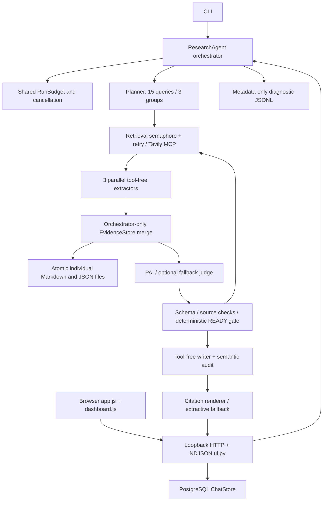

# QA architecture audit (2026-10-12)

The repository uses Python 3.11+, Pydantic 2 schemas, the OpenAI Python SDK for Kimi/AliYun/PAI, HTTPX and MCP for Tavily, psycopg for PostgreSQL, and vanilla JavaScript/CSS. CLI entry points are `cli.main` and `ui.main`. There is no frontend build, task queue, user authentication, or existing CI configuration. The HTTP server binds to loopback, validates Host/Origin, and streams newline-delimited JSON (not SSE). It permits one active UI job; separate `ResearchAgent` instances support asynchronous concurrent runs. History persists chats/events; session files are audit records, not resumable checkpoints. `sequential.py` retains a separate LangGraph compatibility workflow.

## Boundary inventory

| Boundary | Offline test method | Independent/live verification |
| --- | --- | --- |
| Kimi / AliYun chat completion | Real SDK + HTTPX MockTransport, streamed SDK doubles | Explicitly enabled bounded smoke only |
| PAI classifier | Real SDK request capture, malformed schemas, READY rejection | PAI endpoint/model/region features require live validation |
| Tavily Streamable HTTP MCP | FastMCP ASGI server and failure transports | Bounded optional authenticated search |
| Filesystem | Temporary session roots, fsync/replace/write faults | Crash/power loss across multiple files not transactional |
| PostgreSQL | SQL fakes + disposable real schemas via TEST_DATABASE_URL | Required CI integration database |
| Browser/server | Existing Node VM components + real Playwright browsers and fixture server | Browser server uses actual default orchestrator; providers deterministic |
| Search/LLM content | Exact source excerpts, known IDs, adversarial payloads | Semantic accuracy needs human reviewed data |
| Logs/metrics | Metadata allowlist, redaction, usage accounting and replay tests | No distributed OpenTelemetry implementation exists |

## Test layering

Keep the existing unittest and Node built-in suites. Add a suite-selecting unittest runner with coverage, JUnit XML, JSON/Markdown reports, an outbound network guard, reusable provider fixtures, fault and concurrency suites. Use Hypothesis for reservation/schema invariants and Playwright with axe for browser behavior, accessibility and reviewable screenshots. Separate deterministic gate fixtures from the existing 225 **unlabeled** classifier review snapshots. No synthetic label is presented as a human accuracy result.

## Prioritized gaps before implementation

1. Storage failure and path isolation, READY safety, stage timeout/cancellation, retry accounting.
2. SDK HTTP contracts and malformed provider payloads, deterministic synchronized workers.
3. Executable CI stages and honest machine/human reports, measured coverage and load baselines.
4. Browser UI, cancellation/reconnection, accessibility, responsive layouts and visual review.
5. Live provider compatibility, human labeling, production transport/soak data remain separate release gates.

This map was written before the new QA suites. See TESTING.md, MATRIX.md, DEFECTS.md and generated reports for implementation and execution evidence.
