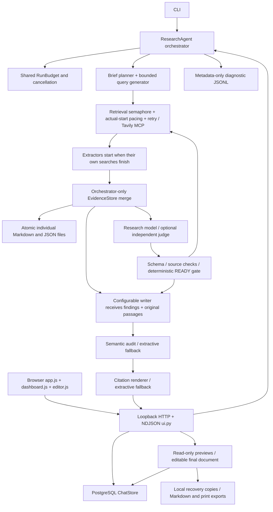

# QA architecture audit (updated 2026-10-13)

The repository uses Python 3.11+, Pydantic 2 schemas, the OpenAI Python SDK for Kimi/AliYun/PAI, HTTPX and MCP for Tavily, psycopg for PostgreSQL, and JavaScript/CSS with a bundled Tiptap/ProseMirror editor. `npm run build:web` builds the checked-in editor bundle with esbuild. CI workflows cover deterministic QA and separate opt-in live smoke. CLI entry points are `cli.main` and `ui.main`. There is no task queue or user authentication. The HTTP server binds to loopback, validates Host/Origin, and streams newline-delimited JSON (not SSE). It permits one active UI job; separate `ResearchAgent` instances support asynchronous concurrent runs. History persists chats/events and independently revisioned edited documents; session files are audit records, not restartable research jobs. `sequential.py` retains a separate LangGraph compatibility workflow.

## Boundary inventory

| Boundary | Offline test method | Independent/live verification |
| --- | --- | --- |
| Kimi / AliYun chat completion | Real SDK + HTTPX MockTransport, streamed SDK doubles | Explicitly enabled bounded smoke only |
| PAI classifier | Real SDK request capture, malformed schemas, READY rejection | PAI endpoint/model/region features require live validation |
| Tavily Streamable HTTP MCP | FastMCP ASGI server and failure transports | Bounded optional authenticated search |
| Filesystem | Temporary session roots, fsync/replace/write faults | Crash/power loss across multiple files not transactional |
| PostgreSQL | SQL fakes + disposable real schemas via TEST_DATABASE_URL | Required CI integration database |
| Browser/server | Existing Node VM components + real Playwright browsers and fixture server | Browser server uses actual default orchestrator; providers deterministic |
| Search/LLM content | Exact source excerpts, known IDs, adversarial payloads | Semantic accuracy needs human reviewed data |
| Logs/metrics | Metadata allowlist, redaction, usage accounting and replay tests | No distributed OpenTelemetry implementation exists |

## Test layering

Keep the existing unittest and Node built-in suites. Add a suite-selecting unittest runner with coverage, JUnit XML, JSON/Markdown reports, an outbound network guard, reusable provider fixtures, fault and concurrency suites. Use Hypothesis for reservation/schema invariants and Playwright with axe for browser behavior, accessibility and reviewable screenshots. Separate deterministic gate fixtures from the existing 225 **unlabeled** classifier review snapshots. No synthetic label is presented as a human accuracy result.

## Prioritized gaps before implementation

1. Storage failure and path isolation, READY safety, stage timeout/cancellation, retry accounting.
2. SDK HTTP contracts and malformed provider payloads, deterministic synchronized workers.
3. Executable CI stages and honest machine/human reports, measured coverage and load baselines.
4. Browser UI, cancellation/reconnection, accessibility, responsive layouts and visual review.
5. Live provider compatibility, human labeling, production transport/soak data remain separate release gates.

Only the controller loop consolidates evidence and publishes synthesis previews. Late worker previews are rejected after synthesis closes. Searches deduplicate in-flight requests with independent waiter cancellation and return deep copies of cached results. Admission and provider pacing precede socket timeouts and paid reservations; each failed transport receives at most three retries under the run deadline. Raw sources remain intact; bounded original passages and omission metadata accompany findings across stages.

The editor uses sanitized Markdown and schema-based document restoration. Formula previews use untrusted MathML rendering; chart previews validate numeric data and build SVG with DOM methods. Source text stays editable/exportable. PostgreSQL document saves use revision compare-and-swap independently of immutable research events. Server failures retain local recovery copies; stale revisions preserve the conflicting copy for export.

See TESTING.md, MATRIX.md, DEFECTS.md, the [upgrade progress](../IMPLEMENTATION_PROGRESS.md), [writer evaluation](../WRITER_EVALUATION.md) and generated reports for execution evidence.
